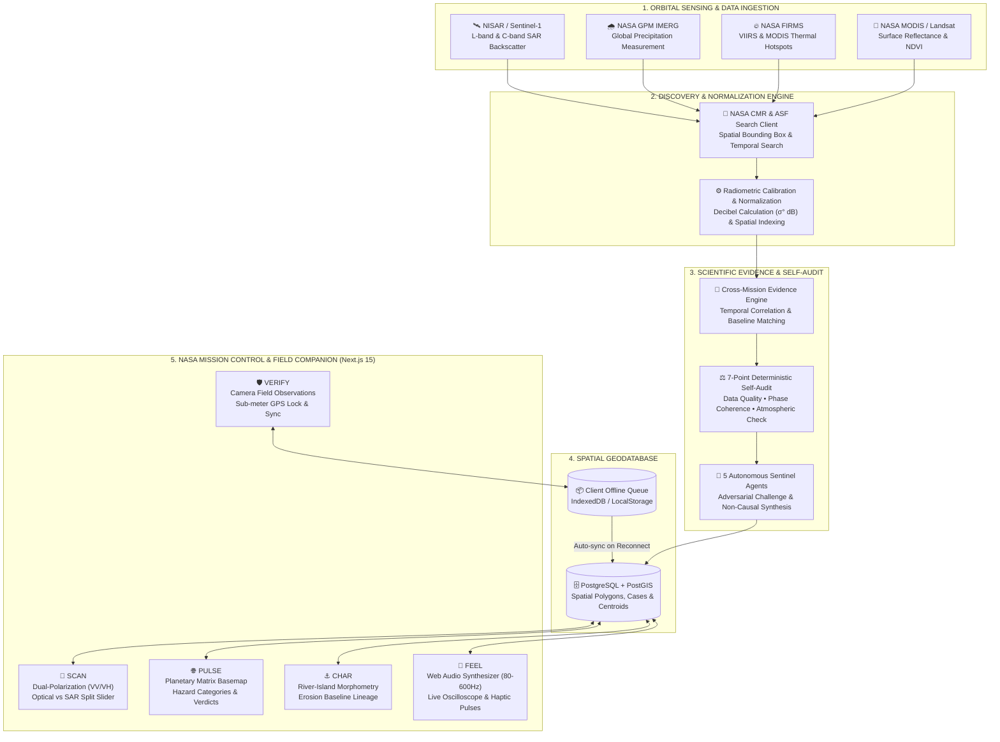

# 🛰️ TRACE — Temporal Radar Assessment & Cross-mission Evidence

<div align="center">

[](https://www.spaceappschallenge.org/)
[](https://traceclient-production.up.railway.app/)
[](https://nextjs.org/)
[](https://fastapi.tiangolo.com/)
[](https://postgis.net/)
[](https://www.typescriptlang.org/)
[](https://developer.mozilla.org/en-US/docs/Web/API/Web_Audio_API)
[](https://turbo.build/)

<br />

**Cloud-piercing radar anomaly detection, multi-mission satellite evidence fusion, audio-haptic sensory sonification, and offline-first ground-truth verification powered by NASA Earthdata & NISAR science.**

### 🌐 [🚀 CLICK HERE TO LAUNCH LIVE APPLICATION](https://traceclient-production.up.railway.app/)

**[Live Web App (Railway)](https://traceclient-production.up.railway.app/)** • **[Production API Docs](https://traceserver-production.up.railway.app/docs)** • [Localhost (3000)](http://localhost:3000) • [Operational Pipeline](#-how-trace-works-the-end-to-end-pipeline) • [The 5 Modules](#-the-5-mission-modules) • [Self-Audit Engine](#-scientific-integrity--the-7-point-self-audit-engine) • [Quick Start](#-quick-start-guide)

</div>

---

## 🧭 Executive Summary

Every year, catastrophic natural disasters — flash floods, monsoonal river-island erosion, hurricane storm surges, and wildfires — strike the most vulnerable communities on Earth. Yet conventional optical Earth observation satellites (such as Landsat and Sentinel-2) are frequently crippled by the **"Cloud Cover Blind Spot"**: monsoon cloud decks, storm canopies, smoke plumes, and nighttime darkness completely obscure the view from space.

**Synthetic Aperture Radar (SAR)**, led by the landmark **NASA-ISRO SAR (NISAR)** and **Copernicus Sentinel-1** missions, pierces through clouds, storms, and darkness 24 hours a day, 7 days a week, utilizing active microwave signals.

However, raw SAR data is mathematically demanding, complex to interpret, and prone to false positives caused by moisture spikes or atmospheric disturbances. **TRACE (Temporal Radar Assessment & Cross-mission Evidence)** bridges the gap between orbit and the ground:

1. **Cloud-Piercing Radar Anomaly Detection**: Ingests L-band and C-band SAR backscatter, calculating calibrated decibel differences ($\Delta\text{dB}$) and surface water inundation masks.
2. **Multi-Mission Evidence Fusion**: Concurrently correlates with **NASA GPM (IMERG precipitation)**, **NASA FIRMS (thermal fire anomalies)**, and **NASA MODIS/Landsat (vegetation context)** for multi-spectral verification.
3. **Deterministic 7-Point Self-Audit**: Forbids AI hallucination by putting every single observation through 7 rigorous mathematical checks before issuing a verdict (`SUPPORTED`, `INCONCLUSIVE`, or `REJECTED`).
4. **5 Autonomous Sentinel Agents**: A collaborative multi-agent pipeline (`DataAgent` ➔ `DetectionAgent` ➔ `EvidenceAgent` ➔ `ChallengeAgent` ➔ `InterpretationAgent`) that acts as an automated scientific advisory board.
5. **FEEL Sensory Sonification**: Converts radar decibels into real-time physical vibrations and acoustic sine frequencies (80 Hz – 600 Hz) with a live oscilloscope display, enabling field rangers and visually impaired scientists to **hear and feel environmental change**.
6. **Offline-First Field Companion**: Geotagged ground photos, GPS precision locks, and an IndexedDB offline queue ensure zero data loss in remote disaster zones.

---

## ⚡ How TRACE Works: The End-to-End Pipeline

The following pipeline illustrates how raw planetary satellite telemetry is ingested, audited, translated, and delivered into the hands of field rangers and decision-makers:



---

## 🌟 The 5 Mission Modules

TRACE is architected into five dedicated operational modules designed for both desktop command centers and mobile field operations:

```
┌─────────────────────────────────────────────────────────────────────────────────────────┐
│                                   TRACE FIELD SYSTEM                                    │
├──────────────┬──────────────┬──────────────┬─────────────────────────┬──────────────────┤
│   🎯 SCAN    │   🌐 PULSE   │   ⚓ CHAR    │         📳 FEEL         │    🛡️ VERIFY     │
│ Detect Radar │ Global Pulse │ River-Island │ Multi-Sensory Sonification│ Field Validation │
│ Anomalies &  │ Surveillance │ Morphometry  │ Real-time Web Audio Hz  │ Offline Photos & │
│ Dual Pol SAR │ & Map Matrix │ & Vulnerable │ & Tactical Haptic Pulse │ Sub-meter GPS    │
└──────────────┴──────────────┴──────────────┴─────────────────────────┴──────────────────┘
```

### 1. 🎯 SCAN — Temporal Radar Inspection & Split Analysis
- **Dual-Polarization Controls**: Toggle seamlessly between **VV** (Vertical transmit / Vertical receive — optimal for open water detection and smooth surfaces) and **VH** (Cross-polarization — optimal for volume scattering and forest canopy penetration).
- **Interactive Optical vs. SAR Split Slider**: Cross-examine visible ground photography against cloud-penetrating synthetic aperture radar backscatter with pointer-drag and 1-tap presets (`Optical Only`, `50/50 Split`, `SAR Only`).
- **Telemetry Inspector**: Deep-dive into temporal decibel delta ($\Delta\sigma^\circ$), baseline timestamps, and spatial extent metrics.

### 2. 🌐 PULSE — Planetary Activity Matrix
- **Real-Time Global Basemap**: Leaflet-powered GIS basemap visualizing active surveillance cases with spatial bounding boxes, centroid pins, and self-audit status tags.
- **Categorical & Risk Filters**: Filter planetary events by hazard classification (*Flood, River Erosion, Wildfire, Coastal Inundation*) and deterministic audit state (*SUPPORTED, INCONCLUSIVE, REJECTED*).
- **Instant Case Navigation**: Tap any planetary target to load comprehensive satellite evidence into the investigation pipeline.

### 3. ⚓ CHAR — River-Island & Coastal Guardian
- **Vulnerable Delta Ecosystems**: Specially built for high-risk river deltas (e.g., the Jamuna-Brahmaputra chars of Bangladesh, vulnerable coastal mangrove shores).
- **Sedimentation & Channel Shift Tracking**: Compares pre-monsoon optical baselines with post-event radar passes to monitor accretion and bank erosion.
- **Strict Non-Causal Phrasing**: Automatically enforces scientifically defensible wording (*"Observed SAR Change"* instead of sensationalized or unverified claims).

### 4. 📳 FEEL — Multi-Sensory Audio & Haptic Sonification
- **Pure Web Audio Frequency Synthesis**: Translates satellite decibel backscatter drops into direct acoustic sine waves ($80\text{ Hz} - 600\text{ Hz}$). A severe flood drop ($-6\text{ dB}$) produces a deep sub-bass vibration ($120\text{ Hz}$), while stable surfaces pitch higher.
- **Live Dynamic Oscilloscope**: Real-time `<canvas>` wave visualization rendering exact sinusoidal frequencies and pulse period metrics.
- **Physical Haptic Motor Stimulation**: Triggers tactile vibration sequences (`navigator.vibrate`) on supported mobile devices, enabling field researchers in harsh glare or visually impaired users to **experience radar changes by touch**.

### 5. 🛡️ VERIFY — Closed-Loop Field Ground Truth
- **Georeferenced Field Reporting**: Community rangers capture camera photos, situational notes, and exact coordinates to validate satellite passes.
- **Offline-First Resilience**: If internet connectivity drops in remote marshlands or disaster zones, observations are queued locally in `IndexedDB/localStorage` and synchronized automatically upon reconnecting.
- **Configurable Anomaly Thresholds**: Set custom alert triggers ($\Delta\text{dB} \le -2.0$) with safe multi-state tracking (*ARMED ➔ TRIGGERED ➔ ACKNOWLEDGED*).

---

## 🔬 Scientific Integrity: The 7-Point Self-Audit Engine

A critical failure in typical AI Earth observation tools is **false confirmation bias** — assuming that any spectral change signifies a crisis. TRACE refuses blind confidence by putting every radar observation through a **Deterministic 7-Point Self-Audit Engine**:

| # | Scientific Check | Target Evaluation | Decision Rule & Threshold |
|---|---|---|---|
| **1** | **Data Completeness & Quality** | Validates SAR payload completeness, raster dimensions, and delta magnitude. | $\Delta\text{dB} \le -1.5\text{ dB}$ confirms notable attenuation. Weak signals ($-1.5 < \Delta\text{dB} \le -0.5$) flag a `WARNING`. |
| **2** | **Interferometric Phase Coherence** | Evaluates InSAR phase correlation ($\gamma$) across consecutive passes. | $\gamma < 0.25$ indicates true decorrelation (flooding / physical displacement). $\gamma > 0.65$ triggers `WARNING` (stable surface). |
| **3** | **Spatiotemporal Sanity** | Checks temporal observation duration and geometric polygon validity. | Flags anomalous single-pixel flashes or unrealistic multi-week static flood claims. |
| **4** | **Atmospheric Artifact Risk** | Evaluates ionospheric disturbances and severe tropospheric moisture delays. | Disqualifies radar artifacts caused by heavy rain cell attenuation rather than ground water. |
| **5** | **Multi-Sensor Cross-Coverage** | Searches for corroborating data from independent NASA instruments. | Cross-correlates precipitation (NASA GPM IMERG) or active fire (NASA FIRMS) during the event window. |
| **6** | **Ground-Truth Concurrence** | Checks matching field observation reports submitted within the bounding box. | Integrates geotagged photos and human inspection into the certainty index. |
| **7** | **Confidence Synthesis** | Produces a mathematically defensible, non-speculative verdict. | Final State: **`SUPPORTED`**, **`INCONCLUSIVE`**, or **`REJECTED`**. |

> [!IMPORTANT]
> **Defensible Non-Causal Terminology:**  
> The TRACE backend strictly forbids speculative causal claims. Generated briefs will **never** state that an anomaly was *"definitively caused by"* without multi-mission proof. Phrasing strictly adheres to defensible language: *"SAR backscatter drop coincides temporally with GPM precipitation anomaly."*

---

## 🤖 The 5 Autonomous Sentinel Agents

TRACE orchestrates 5 specialized AI agents modeled after an interdisciplinary mission science team:

```
[🛰️ DataAgent] ──▶ [🔍 DetectionAgent] ──▶ [📊 EvidenceAgent]
                                                   │
  [📝 InterpretationAgent] ◀── [⚖️ ChallengeAgent] ◀┘
```

1. **`DataAgent`**: Queries NASA CMR and ASF DAAC APIs to discover satellite passes matching the bounding box and observation window.
2. **`DetectionAgent`**: Processes calibrated backscatter, identifies attenuation thresholds, and generates spatial inundation polygons.
3. **`EvidenceAgent`**: Executes spatiotemporal joins with NASA GPM rainfall baselines, FIRMS thermal alerts, and Landsat/MODIS NDVI context.
4. **`ChallengeAgent`**: The scientific adversary. Runs the 7-point self-audit and actively searches for counter-evidence or atmospheric interference before endorsing any claim.
5. **`InterpretationAgent`**: Formulates the final defensible executive briefing, calculating uncertainty bounds and actionable recommendations for disaster management authorities.

---

## 💻 Tech Stack & Monorepo Architecture

TRACE is structured as a high-performance monorepo managed with **Turborepo** and **pnpm**:

| Component | Technology | Rationale |
|---|---|---|
| **Frontend Framework** | **Next.js 15.1.7** (App Router), **React 19** | Zero-hydration server rendering, dynamic routing, and blazing fast client hydration. |
| **Language & Types** | **TypeScript 5.7** | 100% strict type safety across all components, API schemas, and geospatial models. |
| **Design Language** | **NASA Mission Control & SAR Gold** | Deep Basalt (`#080C14`), Titanium Slate borders, and SAR Radar Gold (`#F59E0B`) accents. |
| **Sensory Engine** | **Web Audio API** + **HTML5 Vibration API** | Pure mathematical oscillator sound synthesis and tactile haptic pulse sequences. |
| **Geospatial & Mapping** | **Leaflet 1.9** + Canvas Reticles | Responsive planetary GIS maps, tile layers, and real-time WGS84 coordinate readouts. |
| **Offline Engine** | **IndexedDB / LocalStorage** Queue | Resilient offline observation collection with automatic background network recovery. |
| **Backend Framework** | **FastAPI 0.115+** (Python 3.11+) | Ultra-fast async ASGI REST API with automatic OpenAPI / Swagger interactive documentation. |
| **Spatial Database** | **PostgreSQL** + **PostGIS** / SQLite fallback | Native geospatial polygon indexing, spatial joins, and distance calculations. |
| **NASA APIs** | **CMR Search API**, **ASF DAAC**, **GPM**, **FIRMS** | Direct multi-sensor Earth observation ingestion and granule discovery. |
| **Monorepo Tooling** | **Turborepo 2.4** + **pnpm 12** | Blazing-fast parallel task execution, shared package caching, and clean dependencies. |

---

## 🚀 Quick Start Guide

### Prerequisites
- **Node.js**: `v18.0.0` or higher (v20+ recommended)
- **pnpm**: `v8.0.0` or higher (`npm install -g pnpm`)
- **Python**: `v3.11` or higher
- **Git**

---

### Step 1: Clone the Repository

```bash
git clone https://github.com/sanjidtalukder/TRACE-Platform.git
cd TRACE-Platform
```

---

### Step 2: Environment Configuration

Create local environment files for both frontend and backend from the provided samples:

```bash
# In the root repository directory:
cp .env.example .env
cp client/.env.example client/.env.local
cp server/.env.example server/.env
```

| Variable | Location | Description | Default Value |
|---|---|---|---|
| `NEXT_PUBLIC_API_URL` | `client/.env.local` | Base URL of the running FastAPI server | `http://localhost:8000` |
| `DATABASE_URL` | `server/.env` | Database connection string (PostgreSQL/SQLite) | `sqlite:///./trace_dev.db` |
| `CMR_BASE_URL` | `server/.env` | NASA Common Metadata Repository API | `https://cmr.earthdata.nasa.gov` |
| `EARTHDATA_TOKEN` | `server/.env` | Optional NASA Earthdata Bearer Token | `(anonymous access supported)` |

> [!TIP]
> **No NASA credentials required for immediate testing!**  
> TRACE includes seeded real-world case studies (`TRACE-CHAR-01`, `CASE-017`, `TRACE-2026-001`, `TRACE-WILD-01`), enabling immediate exploration without an Earthdata token.

---

### Step 3: Start the Backend Server (FastAPI)

Open a terminal for the backend:

```bash
# 1. Create and activate a Python virtual environment
python -m venv .venv

# Windows (PowerShell):
.venv\Scripts\Activate.ps1
# Linux / macOS:
source .venv/bin/activate

# 2. Install dependencies
pip install -r server/requirements.txt

# 3. Start the FastAPI development server
uvicorn server.app.main:app --reload --port 8000
```

✅ **Backend Endpoints:**
- **API Root**: [`http://localhost:8000/`](http://localhost:8000/)
- **Interactive Swagger Docs**: [`http://localhost:8000/docs`](http://localhost:8000/docs)
- **Health Check**: [`http://localhost:8000/health`](http://localhost:8000/health)

---

### Step 4: Start the Frontend Client (Next.js)

Open a second terminal for the frontend:

```bash
# 1. Install all monorepo dependencies
pnpm install

# 2. Start the Next.js development server
pnpm --filter client dev
```

✅ **Frontend Verification:**
- **Live Cloud Production URL**: [`https://traceclient-production.up.railway.app/`](https://traceclient-production.up.railway.app/)
- **Local Development Server**: [`http://localhost:3000`](http://localhost:3000)
- The header will display green status beacons for **GPS ACTIVE** and **ONLINE**.

---

### Running Everything Concurrently (Turborepo)

Once dependencies are installed, you can start both the client and server concurrently with one command from the project root:

```bash
pnpm dev
```

---

## 📡 Core API Reference

The TRACE FastAPI backend exposes a clean, self-documenting REST API:

### 1. Case Management & Analysis
| Method | Endpoint | Description |
|---|---|---|
| `GET` | `/api/cases` | List all spatial investigation cases (paginated). |
| `GET` | `/api/cases/{case_id}` | Retrieve comprehensive case telemetry, SAR measurements, and geometry. |
| `GET` | `/api/cases/{case_id}/timeline` | Retrieve chronological observation sequence (BEFORE ➔ CHANGE ➔ AFTER). |
| `POST` | `/api/cases/{case_id}/evaluate-evidence` | Execute multi-mission evidence fusion (GPM, FIRMS, MODIS correlation). |
| `POST` | `/api/cases/{case_id}/self-audit` | Run the 7-Point Scientific Self-Audit Engine. |
| `POST` | `/api/cases/{case_id}/simulate-scenario` | Execute elevation hydrological inundation modeling (+0.5m, +1.0m, +2.0m). |
| `POST` | `/api/cases/{case_id}/run-sentinel-agents` | Trigger the 5-Agent Autonomous Sentinel pipeline. |
| `GET` | `/api/cases/{case_id}/char-history` | Fetch historical river-island morphometry and erosion lineage. |

### 2. Live NASA Earthdata Connectors
| Method | Endpoint | Description |
|---|---|---|
| `GET` | `/api/nasa/nisar/search` | Discover candidate NISAR/SAR Earth observation granules by BBox & date. |
| `GET` | `/api/nasa/gpm/search` | Query NASA GPM IMERG precipitation rates for baseline verification. |
| `GET` | `/api/nasa/firms/search` | Query NASA FIRMS VIIRS/MODIS thermal fire anomalies. |
| `GET` | `/api/nasa/modis/search` | Query NASA MODIS surface context and vegetation index. |
| `GET` | `/api/nasa/health` | Probe NASA CMR reachability and authentication status. |

### 3. Field Ground-Truth & Community Sentinel
| Method | Endpoint | Description |
|---|---|---|
| `POST` | `/api/cases/{case_id}/field-observations` | Submit geotagged field photos, notes, and GPS coordinates. |
| `GET` | `/api/cases/{case_id}/alerts` | List configured decibel anomaly alerts for a case. |
| `POST` | `/api/cases/{case_id}/alerts` | Subscribe to a decibel anomaly alert threshold ($\Delta\text{dB}$). |
| `POST` | `/api/cases/{case_id}/alerts/{id}/acknowledge` | Mark an anomaly alert as acknowledged. |
| `GET` | `/api/global/events` | Planetary aggregator of all active cases with spatial coordinates. |

---

## 🧪 Automated Testing Suite

TRACE includes a rigorous testing suite covering the self-audit engine, evidence fusion, sentinel agent execution, and offline queues:

```bash
# Activate your backend virtual environment
.venv\Scripts\Activate.ps1   # Windows
source .venv/bin/activate     # Linux / macOS

# Run the complete test suite with pytest
pytest server/tests -v
```

```bash
# Validate frontend TypeScript types
pnpm --filter client build
```

---

## 🌍 Real-World Case Studies

| Case ID | Region | Hazard Type | Description |
|---|---|---|---|
| **`TRACE-CHAR-01`** | **Jamuna River Delta, Bangladesh** | River Island Morphometry | Severe monsoonal erosion alters river-island boundaries. Optical satellites are completely obscured by monsoon clouds; TRACE penetrates the cloud cover with SAR to map shoreline shifts. |
| **`CASE-017`** | **Sylhet Haor Basin, Bangladesh** | Flash Flood Inundation | Sudden cloudburst inundates agricultural lowlands. TRACE cross-correlates Sentinel-1 backscatter drops ($-4.82\text{ dB}$) with NASA GPM rainfall spikes ($78\text{ mm/hr}$). |
| **`TRACE-2026-001`** | **Houston / Gulf Coast, USA** | Hurricane Storm Surge | Hurricane landfall creates extensive urban and coastal flooding. The optical-vs-SAR swipe slider reveals standing water beneath dense storm cloud decks. |
| **`TRACE-WILD-01`** | **California Foothills, USA** | Wildfire Burn Scar | NASA FIRMS detects thermal anomalies; subsequent radar passes monitor soil loss and post-fire mudslide vulnerability. |

---

## 📜 Acknowledgements & Data Credits

- **NASA Earth Science Data Systems (ESDS)**: For unrestricted access to global Earth observation datasets.
- **NASA / ISRO NISAR Mission**: For pioneering L-band and S-band radar imaging science.
- **Alaska Satellite Facility (ASF) DAAC**: For SAR data access and infrastructure.
- **NASA Land, Atmosphere Near-real-time Capability for EOS (LANCE)**: For FIRMS active fire data.
- **NASA Global Precipitation Measurement (GPM)**: For IMERG precipitation products.
- **NASA Space Apps Challenge 2026**: For inspiring innovative solutions to planetary environmental challenges.

---

<div align="center">

Made with 🛰️ for the **NASA Space Apps Challenge 2026**  
**TRACE Team** • *Bridging Orbit and Ground with Scientific Rigor*

</div>
